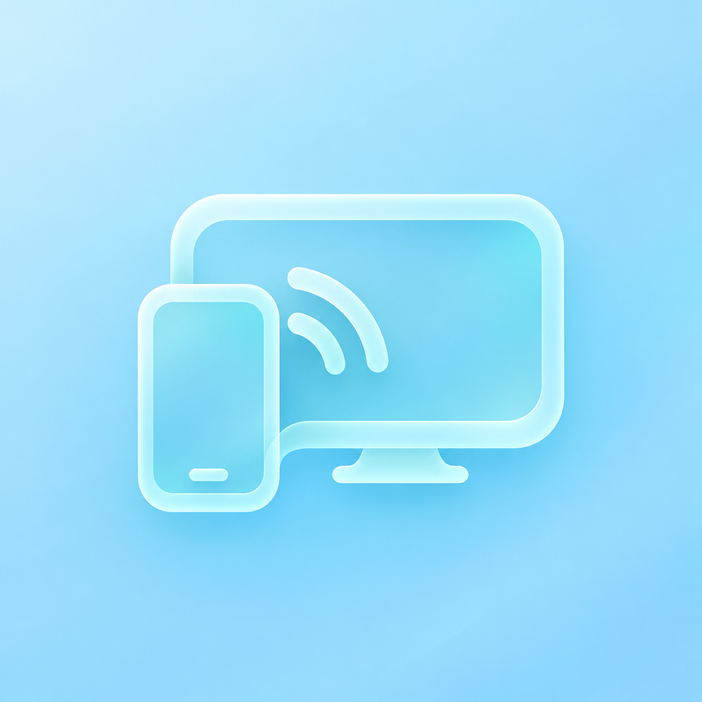

<div align="center">



# SoraCast

**Экран телефона — на вашем телевизоре.**

Локальная трансляция Android → Android TV с открытым исходным кодом.


[](LICENSE)

[Начать](#как-подключиться) · [Собрать](#сборка) · [История изменений](CHANGELOG.md) · [Лицензии](THIRD_PARTY_NOTICES.md)

**[Скачать для телефона](https://github.com/saiferxt/SoraCast/releases/latest/download/SoraCast_phone.apk)** · **[Скачать для TV](https://github.com/saiferxt/SoraCast/releases/latest/download/SoraCast_TV.apk)**

</div>

## Свой экран. Своя сеть.

SoraCast соединяет телефон и телевизор в одной локальной сети. Телевизор показывает QR-код, телефон сканирует его, а первое подключение подтверждается на телевизоре. Учётная запись и облачный сервер для трансляции не нужны.

- **Изображение и звук.** Захват экрана через Android MediaProjection; звук приложений — через AudioPlaybackCapture, если приложение разрешает его захват.
- **Выбор качества.** Авто, 540p24, 720p30, 1080p30/60 и 1440p30/60. Это выбранные пределы: фактическое качество зависит от устройств и сети.
- **Понятная диагностика.** Фактические разрешение, FPS, битрейт и показатели передачи доступны в сеансе. На ТВ кнопка OK переключает информационную панель.
- **Обновления внутри приложения.** Фоновая проверка при открытии не чаще раза в сутки и ручная кнопка на телефоне/TV. APK проверяется по размеру, SHA-256, имени пакета, версии и текущему сертификату; установку подтверждает Android. Файлы выпуска загружаются с GitHub, отдельно от локального медиапотока.
- **Подтверждённое соединение.** Привязка TLS-сертификата, проверка устройства и шифрование медиапотока DTLS-SRTP.

## Как подключиться

1. Установите приложение для телефона на Android 10+ и приложение для ТВ на Android 8+.
2. Подключите оба устройства к одной локальной сети и откройте SoraCast на ТВ.
3. Откройте SoraCast на телефоне и отсканируйте QR-код **в приложении SoraCast**.
4. Подтвердите первое подключение на ТВ, выберите качество и разрешите трансляцию экрана на телефоне.

Начните с **720p30**: этот режим показал хорошую отзывчивость в пользовательской проверке на старой приставке. Более высокие режимы требуют проверки на вашем оборудовании.

> **Ранний preview.** Работа изображения и звука проверялась пользователем в ветке 0.1.4. Версия 0.1.5-preview.1 сосредоточена на обновлениях; её установка через встроенное обновление на физических устройствах ещё не проверена. Состав и доступность готовых сборок указаны в GitHub Releases.

## Что нужно знать

- На телефоне и ТВ должен быть SoraCast. Штатные меню Miracast, Chromecast, AirPlay, Vivo/Oppo и HappyCast не являются поддерживаемыми способами подключения.
- Некоторые приложения запрещают захват защищённого видео или внутреннего звука. Микрофон для передачи звука не используется.
- Доступность профиля 1440p60 не гарантирует, что конкретный телевизор или приставка обработает такой поток плавно. На старой приставке в высоких режимах наблюдались задержка и рывки.
- VPN, включённый до подключения, в пользовательской проверке мешал соединению. При проблемах начните с локальной сети без VPN.
- Одновременно передаёт один телефон. Передача файлов, новый стеклянный интерфейс и профиль 720p60 остаются планами и в этот preview не входят.

## Сборка

Нужны **JDK 17**, **Android SDK 35**, **Build Tools 35.0.0**. Проект использует **Gradle 8.13** и **Android Gradle Plugin 8.9.2**. На Windows используйте каталог проекта с латинскими символами в пути.

```text
android/       приложения phone и tv, общая Android-часть, WebRTC Java runtime
core/          правила сеанса и протокола, независимые от Android
assets/        иконка проекта
licenses/      лицензии сторонних компонентов
```

Публичное дерево содержит исходники. Четыре готовые native-библиотеки WebRTC нужно получить отдельно из закреплённой версии ScreenStream:

```powershell
.\tools\fetch-runtime.ps1
```

Скрипт сверяет SHA-256. Источник, хэши и ограничения описаны в [THIRD_PARTY_NOTICES.md](THIRD_PARTY_NOTICES.md).

После подготовки runtime задайте `ANDROID_HOME` или создайте собственный `android/local.properties` с `sdk.dir`, затем:

```powershell
cd android
.\gradlew.bat :common:testDebugUnitTest :runtime:testDebugUnitTest :phone:lintDebug :tv:lintDebug :phone:assembleDebug :tv:assembleDebug
```

В Linux/macOS используйте `./gradlew`. Собранные APK находятся в `android/phone/build/outputs/apk/debug/` и `android/tv/build/outputs/apk/debug/`. Локальная подпись отличается от подписи официального выпуска: поверх официального APK такая сборка обычно не установится. Ключ выпуска в репозиторий не входит.

TLS-тесты создают временные ключи средствами JDK во время запуска и удаляют временные файлы. Готовых ключей и хранилищ сертификатов в репозитории нет.

## Сообщить о проблеме

Приложите версию SoraCast, модели устройств, версии Android, выбранное качество и текст «Показателей передачи». Укажите, работает ли 720p30, включён ли VPN и на каком этапе возникает ошибка. Перед отправкой удалите из материалов QR-коды, адреса сети и личное содержимое экрана.

## Открытый код

Собственный код SoraCast — **MIT**, © 2026 [saiferxt](https://github.com/saiferxt). WebRTC, JNI Zero, ZXing и другие сторонние компоненты сохраняют свои лицензии и авторство: [THIRD_PARTY_NOTICES.md](THIRD_PARTY_NOTICES.md).

Спасибо авторам [WebRTC](https://webrtc.org/), [ScreenStream](https://github.com/dkrivoruchko/ScreenStream) и [ZXing](https://github.com/zxing/zxing).
