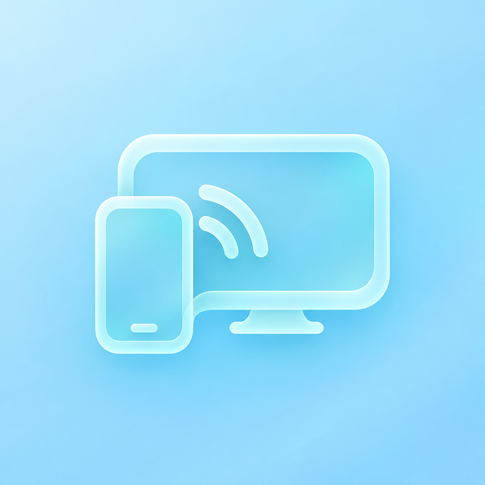

<div align="center">



# SoraCast

**[RU](README.md) · ENG**

**Your phone screen, on your TV.**

Open-source Android → Android TV screen mirroring over your local network.


[](LICENSE)

[Get started](#connect-your-devices) · [Build](#building) · [Changelog (RU)](CHANGELOG.md) · [Licenses](THIRD_PARTY_NOTICES.md)

**[Download for phone](https://github.com/saiferxt/SoraCast/releases/latest/download/SoraCast_phone.apk)** · **[Download for TV](https://github.com/saiferxt/SoraCast/releases/latest/download/SoraCast_TV.apk)**

</div>

## Your screen. Your network.

SoraCast connects your phone and TV on the same local network. The TV displays a QR code, your phone scans it, and you approve the first connection on the TV. Screen mirroring needs no account or cloud server.

- **Video and audio.** Screen capture uses Android MediaProjection. Internal app audio uses AudioPlaybackCapture when the source app permits it.
- **Quality selection.** Auto, 540p24, 720p30/60, 1080p30/60, and 1440p30/60. These are upper limits; actual quality depends on your devices and network.
- **Stream information.** Actual resolution, FPS, bitrate, and transmission statistics are available during a session. Press OK on the TV remote to toggle the information panel.
- **In-app updates.** Automatic checks on launch run at most once a day; manual checks are available on the phone and TV. Before installation, SoraCast checks the APK size, SHA-256, package name, version, and signing certificate. Android asks you to confirm installation. Release files are downloaded from GitHub separately from the local media stream.
- **Approved connections.** TLS certificate pinning, device verification, and DTLS-SRTP media encryption.

## Connect your devices

1. Install the phone app on Android 10+ and the TV app on Android 8+.
2. Connect both devices to the same local network and open SoraCast on the TV.
3. Open SoraCast on your phone and scan the TV QR code **inside the SoraCast app**.
4. Approve the first connection on the TV, choose a quality mode, and allow screen sharing on your phone.

Start with **720p30**. For smoother motion, select **720p / 60**; the actual frame rate depends on your devices and network.

> **Early preview.** Bugs and performance limitations are possible. See [GitHub Releases](https://github.com/saiferxt/SoraCast/releases) for available builds and their features. Previous versions remain available there too.

## Things to know

- Both the phone and TV need SoraCast. Built-in Miracast, Chromecast, AirPlay, Vivo/Oppo, and HappyCast menus are not supported connection methods.
- Some apps prevent capture of protected video or internal audio. SoraCast does not use the microphone to transmit sound.
- A 1440p60 option does not guarantee smooth playback on a particular TV or box. Older hardware may show delay and stuttering at higher settings.
- A VPN enabled before connecting can interfere with the connection. If you have problems, start with your local network without a VPN.
- One phone transmits at a time. File sharing and the new glass interface are planned and are not included in this preview.

## Building

Requirements: **JDK 17**, **Android SDK 35**, and **Build Tools 35.0.0**. The project uses **Gradle 8.13** and **Android Gradle Plugin 8.9.2**. On Windows, use a project path containing Latin characters.

```text
android/       phone and TV apps, shared Android code, WebRTC Java runtime
core/          Android-independent session and protocol rules
assets/        project icon
licenses/      third-party licenses
```

The public tree contains source code. Download the four prebuilt WebRTC native libraries separately from the pinned ScreenStream revision:

```powershell
.\tools\fetch-runtime.ps1
```

The script checks SHA-256 hashes. Sources, hashes, and limitations are documented in [THIRD_PARTY_NOTICES.md](THIRD_PARTY_NOTICES.md).

Once the runtime is ready, set `ANDROID_HOME` or create your own `android/local.properties` with `sdk.dir`, then run:

```powershell
cd android
.\gradlew.bat :common:testDebugUnitTest :runtime:testDebugUnitTest :phone:lintDebug :tv:lintDebug :phone:assembleDebug :tv:assembleDebug
```

On Linux/macOS, use `./gradlew`. Built APKs are located in `android/phone/build/outputs/apk/debug/` and `android/tv/build/outputs/apk/debug/`. A local build uses a different signature from the official release, so it normally cannot be installed over an official APK. The release signing key is not included in the repository.

## Report a problem

Include your SoraCast version, device models, Android versions, selected quality, and the stream statistics text. Mention whether 720p30 works, whether a VPN is enabled, and at which step the error occurs. Remove QR codes, network addresses, and personal screen content before submitting.

## Open source

SoraCast's own code is **MIT**, © 2026 [saiferxt](https://github.com/saiferxt). WebRTC, JNI Zero, ZXing, and other third-party components retain their licenses and attribution: [THIRD_PARTY_NOTICES.md](THIRD_PARTY_NOTICES.md).

Thanks to the authors of [WebRTC](https://webrtc.org/), [ScreenStream](https://github.com/dkrivoruchko/ScreenStream), and [ZXing](https://github.com/zxing/zxing).
